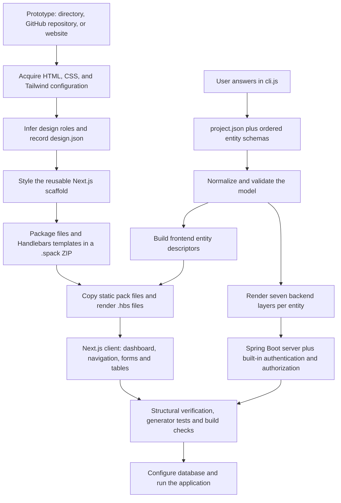

# How StockPro generation works

This project combines two inputs: a reusable frontend design and a structured business model supplied by the user. The design chooses the appearance; the model chooses the entities, fields, relations, API paths, validation, and available operations. The current implementation uses JavaScript, CSS analysis, and Handlebars. It does not use an LLM to interpret answers or infer business rules.

The reference is [Mahmoud5777/stockpro](https://github.com/Mahmoud5777/stockpro). The implementation work inspected the matching local checkout at `D:/stock_pro`, on its `yacine` branch. That is a local reference, not a claim that the remote default branch is identical.

## The complete pipeline



There are two independent preparation paths that meet in frontend generation. You can prepare a design pack once and reuse it with many domain models. You can also regenerate one domain model using different packs.

## 1. Acquire information from the prototype

`site-to-spack/lib/acquire-source.js` determines the source type.

| Input | What is read | Important boundary |
| --- | --- | --- |
| Local directory | CSS files, Tailwind configuration, package metadata and project files | Use the frontend folder for a repository containing both backend and frontend |
| GitHub repository | A codeload ZIP; CSS and Tailwind configuration inside it | Explicit `/tree/<branch>` selects a branch; otherwise it tries HEAD, main and master |
| Website URL | Initial HTML, linked stylesheets, inline styles and one level of CSS imports | It does not execute the website's JavaScript or inspect computed browser styles |

Local traversal skips dependencies, Git metadata and build output. Framework detection reads package dependencies. Tailwind configuration is parsed as source text; it is not executed. Imported JavaScript variables, functions, plugin-generated values and arbitrary expressions are outside that parser's capabilities.

For this prototype, the most useful input was `D:/stock_pro/frontend`. Its Tailwind configuration contains the blue brand scale, surface colors, font-family names, shadows and animation definitions. The CSS mainly uses `@apply`, so raw CSS color counts are low even when useful Tailwind hints were extracted.

## 2. Extract the design

`parse-css.js` uses PostCSS to collect declarations, colors, font sizes, font families, radii, spacing, shadows, transitions, button states and keyframes. `mergeAnalyses()` combines those observations across stylesheets while preserving each color object and its occurrence count.

`design-tokens.js` groups colors using weighted clustering in a circular hue representation. Frequent colors suggest background, text, primary and secondary roles. This is a heuristic: a frequently used color is not necessarily the brand color.

Explicit evidence takes precedence. Recognized component selectors such as `body`, `.card`, `.btn-primary` and `.sidebar` provide semantic roles. Tailwind theme hints then override inferred values. For a brand scale without `DEFAULT`, the extractor prefers shade 600, then 500. Missing values receive scaffold defaults.

`analyze-buttons.js` keeps button families separate. `.btn-primary:hover` belongs to the primary family; `.btn-danger` belongs to danger. Shared `.btn` styles supply dimensions and transitions. This prevents one variant from overwriting the color of every button.

The output `design.json` records:

- source information;
- palette and typography;
- radius, shadow and spacing scales;
- button styles and state variants;
- CSS and Tailwind keyframes and animation utilities;
- observation counts and the names of extracted Tailwind hint categories.

The field named `confidence` contains counts, not probabilities or a measured visual similarity score. A color count of zero can coexist with a correct primary color taken from Tailwind. `meta.fidelity` identifies this path as `design-tokens`.

## 3. Convert the design into a reusable pack

`render-template.js` copies the design scaffold and writes token variables, component styles and animations. Tailwind utilities use CSS variables so the theme can change at runtime. Its generated configuration is valid TypeScript; raw CSS keyframes are emitted in CSS, rather than incorrectly placed into Tailwind's object-shaped keyframe configuration.

`design-to-spack.js` calls `site-to-spack/lib/pack.js`. The pack is a ZIP with this layout:

```text
pack.json
package.json
tailwind.config.ts
src/app/globals.css
src/app/...                   static application files
src/features/...              reusable UI and API code
src/lib/entities-registry.ts.hbs
```

`pack.json.templates` lists the files that must be rendered. The archive must contain their actual bytes. The registry template is stored at `src/lib/entities-registry.ts.hbs`, and becomes `src/lib/entities-registry.ts` in the generated client.

For a finished custom frontend, `tools/pack-frontend.js` copies the supplied project files directly. This preserves its components, images and layout to the extent they are present in that project. Supplying a registry template does not automatically rewrite that frontend's domain-specific pages: those pages need to consume the registry or have their own Handlebars adapters.

The design-extraction path reconstructs screens from a shared scaffold. It does not automatically preserve arbitrary prototype layouts, images, downloaded web fonts, React component behavior or business workflows. For exact visual fidelity, adapt and pack the actual prototype components. The new `stockpro.spack` preserves extracted design tokens and uses an improved StockPro-style shell; it is not a pixel-perfect copy of every prototype screen.

## 4. Collect information from the user's answers

`cli.js` asks application questions, generation targets, feature flags, security settings, frontend settings and entity definitions. It accepts an interactive terminal or newline-separated answers from standard input. Blank lines accept defaults; choice and boolean prompts have their own normalization rules.

Names are converted to Java-friendly forms. For example, an entity name becomes PascalCase, field names become camelCase, and default table/column names use uppercase snake case. Explicit API paths remain separate from frontend navigation paths.

| Answer or schema property | Stored location | Generated effect |
| --- | --- | --- |
| Application name | `project.json.appName` | Frontend title, login branding and dashboard shell |
| Backend/frontend/both | `project.json.targets` | Output project layout and which generators run |
| Template pack | `project.json.frontend.templatePath` | Which frontend files and templates are used |
| Entity name/module | Entity schema | Java classes and packages; frontend route and grouped menu |
| Table, ID field, ID type | Entity schema | JPA persistence, DTO identifier and frontend row identity |
| Field name/type | `entity.fields` | Java property, TypeScript type and form control |
| Required/length/email metadata | Field schema | DTO validation and frontend input constraints |
| Write-only | Field schema | JSON write-only behavior, password control and exclusion from table columns |
| Relations | `manyToOne`, `oneToMany`, `relationIds` | JPA relations or ID columns, DTO foreign IDs and relation controls |
| Pagination/search/export | `entity.features` | List API shape, query behavior and frontend controls |
| Security level | `entity.securityLevel` | Available controller operations and matching frontend actions |
| Method security | `entity.features.security` | Whether entity controllers emit `@PreAuthorize` |
| Theme setting | Frontend feature configuration | Optional light/dark toggle |

After all entities are collected, the wizard resolves relation metadata against the complete entity set. A forward reference can therefore receive the target's actual module, ID type and ID field. It writes the manifest and numbered schema files, then launches the generators as child processes.

Several application questions are currently descriptive metadata. The backend still emits the fixed `com.stockpro` package, Maven project, Java 17 release, Spring Boot 3.5.4, PostgreSQL configuration and JWT authentication. Choosing another package, database, build tool or authentication type in the wizard does not implement that alternative. Audit fields, soft delete, internationalization and the API-documentation toggle also lack complete generation support. These are extension points, not completed capabilities.

## 5. Normalize and validate the model

`generate.js.loadSchemas()` reads JSON files in alphabetical order and normalizes each entity. It fills derived properties such as service/repository variable names, capitalized getter names, permission codes, sort fields, imports and operation flags.

`validate.js` checks identifiers, supported types, required-field messages, duplicate tables/routes and relation existence. Strict relation checking aborts generation for missing targets. The frontend also rejects collisions with reserved routes such as `dashboard`, `login` and `api`.

For manually authored schemas, provide explicit `targetModule`, `targetIdType` and `targetIdField` for cross-module or nonstandard-ID relations. The wizard supplies these when it collects the complete graph. Validation does not replace compiling the emitted code, and it does not infer custom business rules from a prototype.

## 6. Generate the backend

Every entity renders seven Handlebars layers:

| Layer | Responsibility |
| --- | --- |
| Entity | JPA table mapping, properties, identifiers and relations |
| DTO | API payload, flat relation IDs and validation annotations |
| Repository | Persistence and specification execution |
| Mapper | Convert entity fields to/from DTO fields |
| Service | Public business-service contract |
| Service implementation | CRUD, relation resolution, search and typed equality filters |
| Controller | HTTP endpoints, pagination, validation and method authorization |

UUID IDs use UUID values. String IDs use UUID text. Long IDs use database identity generation. They no longer depend on millisecond timestamps that can collide.

Relations are resolved by loading the target through its repository. The client sends `supplierId`; the service resolves the Supplier entity. Two relations to the same target share a resolver rather than generating duplicate Java methods.

Search builds case-insensitive OR predicates across non-write-only String fields. Literal `%`, `_` and backslash characters are escaped. Filters build equality predicates for declared fields, using the declared Java type. Pagination applies through the repository; export uses the same search/filter specification. The unpaged list endpoint returns the full list.

The core templates add authentication, token services, administration entities, authorization, exception handling, Excel export and configuration. The bootstrap initializer now includes generated entity permission codes when it creates functionality records and grants the seeded admin profile access. Backend authorization remains the authority for each request.

An input schema can collide with a core administration class. The generator skips core files with the same output path; arbitrary replacements of core User/Role contracts can break other core services. Keep the built-in contracts compatible when extending administration.

## 7. Combine the pack with the model

`generate-frontend.js` validates the pack and schemas, then creates a frontend descriptor for each entity. A descriptor carries its real ID field, API path, module, label, field controls, validation metadata, operation flags and relation choices.

Example transformation:

```text
User answer: Invoice has a required Supplier relation
Schema: fieldName=supplier, targetIdType=Long, targetIdField=supplierId
Backend DTO: Long supplierId
Frontend descriptor: numeric select named supplierId
Form payload: { supplierId: 42 }
Service: supplierRepository.findById(42)
Persistence: Invoice references the resolved Supplier
```

The generator renders the registry from serialized JSON. Quotes and line breaks in labels remain valid TypeScript instead of breaking a string literal. Templates can access `entities`, `project`, `frontend`, `registryJson` and `appJson`.

Static files are copied unchanged. Registered `.hbs` files render in a temporary staging directory and lose the `.hbs` suffix. Pack paths are checked before any extraction; missing template bytes fail generation. Existing client files are preserved unless `--force` is supplied. `--dry-run` lists planned output without writing the client.

## 8. How the generated app handles a request

```mermaid
sequenceDiagram
  participant User
  participant UI as Next.js form/table
  participant Cache as TanStack Query
  participant API as Spring controller
  participant Service
  participant DB as Repository/database
  User->>UI: Search, submit, edit or delete
  UI->>Cache: Query or mutation
  Cache->>API: /api/entity path plus JWT and payload
  API->>API: Authorization and DTO validation
  API->>Service: Valid request
  Service->>DB: Query, resolve relation IDs, or persist
  DB-->>Service: Entity or page
  Service-->>API: Mapped DTO or page
  API-->>Cache: JSON response
  Cache-->>UI: Updated data; invalidate affected queries
  UI-->>User: Rows, pending state, result or error
```

The Next.js rewrite sends `/api/*` to the backend on port 8080. Axios attaches the access token. Login loads `/api/auth/me` for user details. List queries retain page totals. Search is debounced; forms use typed controls; relation options come from the target's full-list endpoint; mutations invalidate cached lists. The dashboard shows actual API counts and marks unavailable data rather than inventing values.

Frontend operation flags reflect the configured security level. They are not a complete per-user permission system: the backend can still deny an action for a particular user. The frontend currently lacks a full refresh-token lifecycle and complete permission-aware menu filtering.

## 9. Reproduce the generated example

Run these from the generator directory, using an installed Node.js runtime:

```powershell
# Refresh the default pack and the extraction scaffold after editing canonical UI files.
node tools/refresh-frontend.js

# Extract and pack the referenced local prototype's design.
node site-to-spack/extract-design.js D:/stock_pro/frontend --out artifacts/stockpro-design
node site-to-spack/design-to-spack.js artifacts/stockpro-design templates/frontend/packs/stockpro.spack --name stockpro-prototype --framework next

# Generate the two projects from the existing example schemas.
node generate.js generated-app/schemas generated-app/server --strict-relations --force
node generate-frontend.js generated-app/schemas generated-app/client --frontend-template templates/frontend/packs/stockpro.spack --force

# Check structure and regression tests.
node verify-app.js generated-app
npm test

# Build each generated project.
cd generated-app/server
mvn compile
cd ../client
npm install
npm run build
```

Use `node cli.js --skip-run` to collect a new domain model. For source code available only on GitHub, a branch URL can be passed to the extractor; its CSS/Tailwind analysis still does not migrate the prototype's complete business functionality.

To run locally, configure PostgreSQL and the backend's environment variables, start `mvn spring-boot:run` in the server directory, then `npm run dev` in the client directory. The default development login is `admin / admin123`. Generation and compilation do not require connecting to the application database; exercising authenticated CRUD does.

## 10. Verify quality and know the remaining boundaries

`verify-app.js` checks the manifest, each entity's Java layers, required client entry points, registry names, conflicting dashboard routes and unresolved templates. It excludes dependency/build folders. A missing client now fails instead of passing with zero verified files.

The regression suite covers the pack round trip, model validation, relation metadata, quoted labels, dry-run, overwrite behavior, invalid pack paths, missing frontend files and disabled feature combinations. Separate Maven and Next.js builds catch errors the structural verifier cannot.

This pass validated 31 tests, compiled the example backend, and compiled a second backend fixture containing custom String/Long IDs, UUID/decimal/date fields, cross-module relations and repeated relation targets. Build results and limitations are recorded in [IMPROVEMENTS.md](IMPROVEMENTS.md).

Remaining work for full prototype parity includes adapting the prototype's exact components and page layouts, preserving font/image assets, implementing its specialized administration workflows, completing per-user UI permissions and token refresh, and making the currently descriptive wizard settings drive backend templates. Generic CRUD cannot derive calculations, approval flows, dashboards or other business logic from colors and user field definitions alone.
